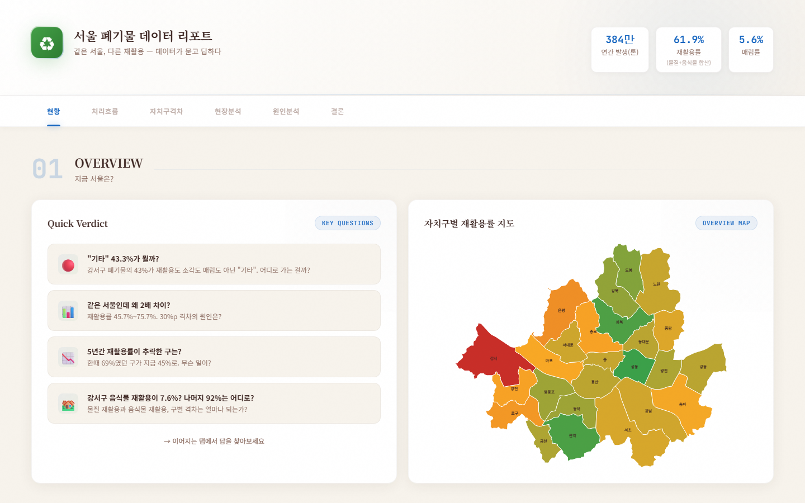
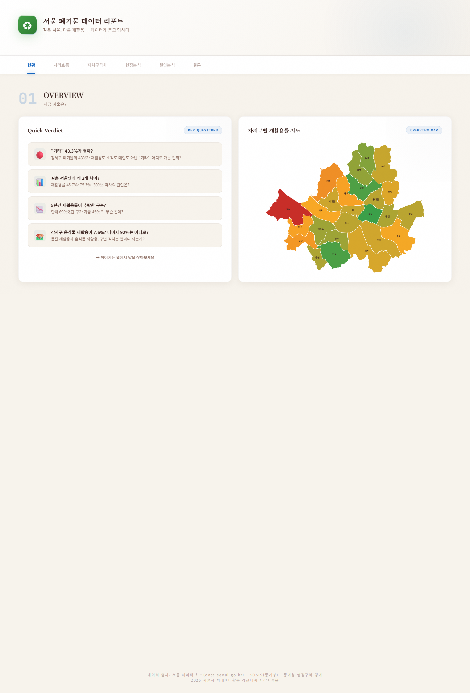
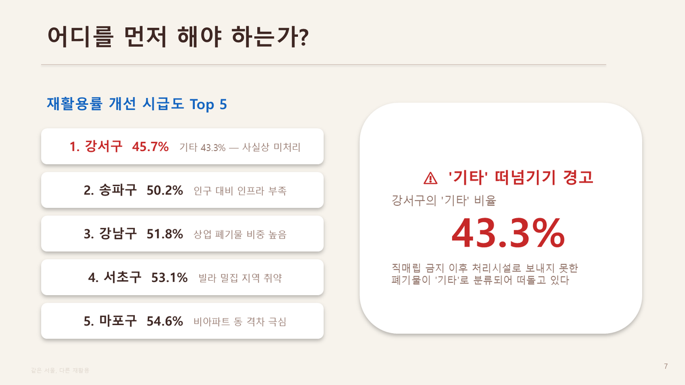
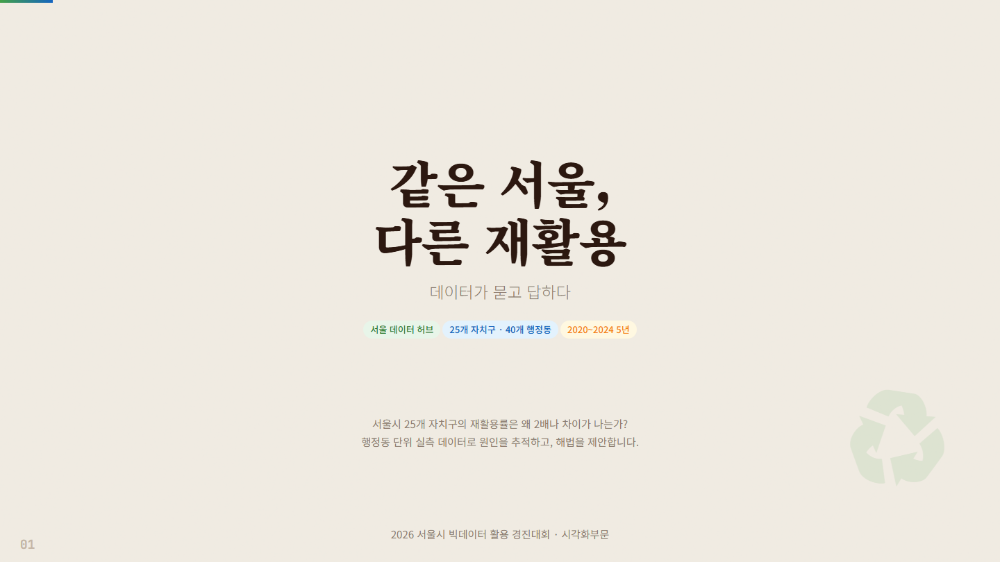
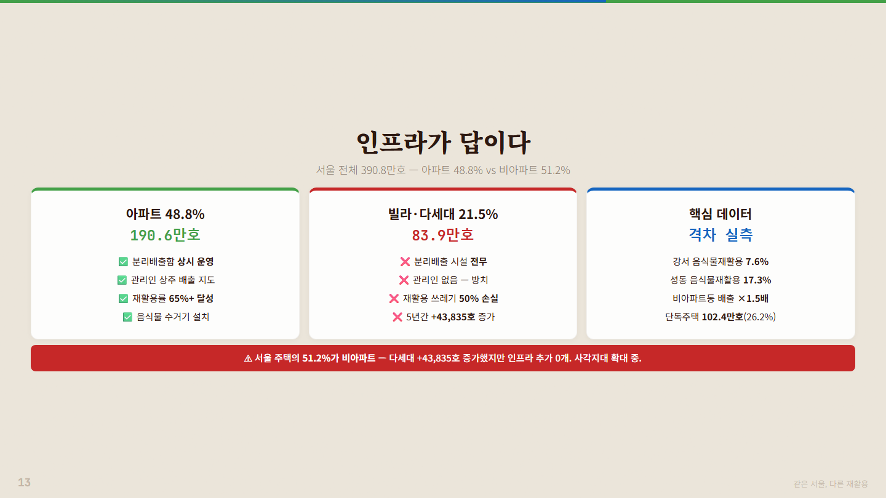

# 같은 서울, 다른 재활용 — 서울 폐기물 데이터 리포트

2026.05 · 2026 서울시 빅데이터 활용 경진대회 시각화 부문 (서울 데이터 허브 활용) · 팀 쓰고링 2인 · 역할: 주제 제안, 데이터 수집·전처리·분석 (대시보드 디자인·발표자료 레이아웃은 생성형 AI 보조) · 결과: 제출 완료, 미입상

## 프로젝트 소개

2026년 1월 수도권 직매립 금지 시행을 계기로, 서울 25개 자치구의 생활폐기물 처리 흐름과 재활용률 격차를 공개 데이터 7종으로 추적한 시각화 리포트입니다. 자치구 단위 Sankey·Choropleth에서 출발해 1인가구·주택유형과 재활용률을 교차 분석하고, 강서구·마포구 행정동 배출량으로 비아파트 밀집 사각지대를 찾아 **공동 분리수거장 우선 설치 5곳**을 제안했습니다. 산출물은 6탭 인터랙티브 HTML 대시보드, 발표자료 19장, 결과보고서입니다.

## 문제 정의

- **배경**: 2026년 1월 수도권 직매립 금지 시행. 그런데도 자치구 재활용률은 성동구 75.7% ~ 강서구 45.7%로 **30%p 격차**
- **질문**: 같은 정책 아래 왜 2배 차이가 나는가? 행정동 단위로 보면 어디에 무엇을 설치해야 하는가?

## 데이터

모두 공개 데이터이며 **원천 CSV·GeoJSON을 `data/raw/`에 그대로 포함**했습니다 (공공누리 1유형 / MIT). 전처리 결과 JSON 14개는 `data/processed/`에 있습니다. 상세 설명(컬럼·인코딩·행수·용도)은 `data/README_sources.txt`를 참고하세요.

| # | 데이터 | 출처 | URL |
|---|---|---|---|
| 1 | 생활계폐기물 발생량 및 처리현황 (2020년 이후) | 서울 열린데이터광장 (원출처 환경부 자원순환정보시스템) | https://data.seoul.go.kr/dataList/DT201004O1200092020/S/2/datasetView.do |
| 2 | 주택현황 및 보급률 (새로운 산정방식, 2015년 이후) | 서울 열린데이터광장 (원출처 국토교통부) | https://stat.eseoul.go.kr/statHtml/statHtml.do?orgId=201&tblId=DT_201004_O090002 |
| 3 | 일반가구 행정구역별 주택유형 | KOSIS (국토교통부 주거실태조사) | https://kosis.kr/statHtml/statHtml.do?orgId=116&tblId=DT_MLTM_5403 |
| 4 | 1인가구 (연령별) | 서울 열린데이터광장 | https://data.seoul.go.kr/dataList/10995/S/2/datasetView.do |
| 5 | 서울특별시 강서구 행정동별 쓰레기 배출량 (2019–2020) | 서울 열린데이터광장 (강서구 자원순환과), OA-21809 | https://data.seoul.go.kr/dataList/OA-21809/F/1/datasetView.do |
| 6 | 서울특별시 마포구 행정동별 쓰레기 배출량 (2019, 2020, 2024) | 서울 열린데이터광장 (마포구) | data.seoul.go.kr (마포구 행정동별 쓰레기 배출량) |
| 7 | 서울시 25개 자치구 경계 GeoJSON | southkorea/seoul-maps (원출처 통계청 2013 행정구역 경계) | https://raw.githubusercontent.com/southkorea/seoul-maps/master/kostat/2013/json/seoul_municipalities_geo_simple.json |

규모: 자치구 25개 × 5개년(2020–2024), 강서구 24개 동, 마포구 16개 동. 샘플 데이터는 별도로 두지 않았습니다 (원천이 소용량 공개 데이터라 그대로 포함).

## 분석 방법

1. 자치구 5개년 처리 흐름(재활용·소각·매립·기타) → Sankey, Choropleth
2. 1인가구·주택유형·재활용률 교차 → "1인가구 ≠ 저재활용" 반박 (관악구)
3. 강서구 24개 동, 마포구 16개 동 행정동 배출량으로 비아파트 밀집동 사각지대 추적
4. 공동 분리수거장 우선 설치 후보 5곳 선정, 기대효과(가정 기반 예상치) 산정


### AI 활용 범위

주제 설정·데이터 선정·전처리·해석은 본인이 수행했고, 대시보드 디자인과 발표자료 레이아웃은 생성형 AI의 보조를 받았습니다. 포함된 코드는 모두 설명 가능한 범위입니다.

## 기술 스택

- **전처리**: Python (표준 라이브러리 csv · json)
- **시각화**: D3.js (Sankey), Plotly.js, deck.gl + MapLibre GL (3D 지도), HTML/CSS/JS 단일 파일 대시보드
- **발표자료**: python-pptx 생성 스크립트, HTML 슬라이드(`slides_v8.html`) → PDF
- **보조**: 생성형 AI (디자인·레이아웃)

## 결과

- 2020→2024 매립 **−38.3%**, 기타 처리 33배 증가
- 고령 1인가구 증가율 **+37.1%** (청년의 1.7배). 관악구 1인가구 비율 57.1%(1위)인데 재활용률 74.3%(2위)
- 강서구 비아파트 밀집동 배출량 1.5배 (화곡1동 5,893,150 kg 최다). 마포구 합정 +30.2%, 도화 +30.5% / 공덕 −19.3%, 서강 −24.5%
- **제안**: 공동 분리수거장 우선 설치 5곳 (화곡1동·화곡본동·발산1동·서교동·합정동). 기대효과(가정 기반): 5개소 약 1.5억 원으로 반경 300 m 약 3.2만 세대 재활용률 15–25%p 개선
- **결과물**: 6탭 대시보드 (시각화 8종: Sankey·Choropleth·Scatter·3D 지도 등), 발표자료 19장, 결과보고서 — 대회 결과 미입상

| 대시보드 | 대시보드 전체 |
|---|---|
|  |  |

| 슬라이드 | 발표자료 | 발표자료 — 제안 |
|---|---|---|
|  |  |  |

## 실행 방법

### 대시보드 보기

`result/dashboard.html`을 브라우저에서 열면 됩니다 (데이터는 HTML 안에 포함). D3·Plotly·deck.gl·MapLibre·웹폰트를 CDN에서 불러오므로 **인터넷 연결이 필요**합니다. `result/결과시각화_제출용.html`은 제출 시 파일명으로, `dashboard.html`과 동일한 파일입니다. 발표자료는 `result/slides_v8.html`(방향키로 넘김) 또는 `result/slides_v8.pdf`로 볼 수 있습니다.

### 전처리 재실행

```bash
cd scripts
python data_processing.py      # data/raw/*.csv → data/processed/*.json (표준 라이브러리만 사용)
```

- 스크립트는 `../01.data/01.raw_data`, `../01.data/02.pre_data` 경로를 기준으로 작성되어 있습니다. 이 레포 구조에서는 상단의 `RAW_DIR`, `OUTPUT_DIR`을 각각 `../data/raw`, `../data/processed`로 수정하세요.
- 강서구 CSV는 코드에서 `강서구_행정동별_쓰레기배출량_2020.csv`라는 이름으로 읽습니다. `data/raw/서울특별시 강서구_행정동별 쓰레기 배출량_20201231.csv`를 그 이름으로 복사하거나 코드의 파일명을 바꾸세요. 일부 CSV는 EUC-KR 인코딩입니다 (`data/README_sources.txt` 참고).

### 발표자료(pptx) 생성

```bash
pip install -r requirements.txt   # python-pptx, lxml
cd scripts && python create_pptx.py
```

- 저장 경로 `out_path`(작성 당시 WSL 절대 경로)가 하드코딩되어 있으니 환경에 맞게 수정하세요. 최종 제출 발표자료는 이 스크립트 결과가 아니라 HTML 슬라이드(`slides_v8.html`)를 PDF로 출력한 것입니다.

## 폴더 구조

```
seoul-waste-recycling-viz/
├── README.md
├── requirements.txt
├── scripts/
│   ├── data_processing.py        # 원천 CSV → 전처리 JSON
│   └── create_pptx.py            # python-pptx 발표자료 생성 (초기 버전)
├── data/
│   ├── README_sources.txt        # 데이터 7종 출처·컬럼·인코딩·용도
│   ├── raw/                      # 공개 원천 CSV 6종 + 자치구 경계 GeoJSON
│   └── processed/                # 전처리 JSON 14개
├── result/
│   ├── dashboard.html            # 6탭 인터랙티브 대시보드 (단일 파일)
│   ├── 결과시각화_제출용.html      # 제출 파일명 (dashboard.html과 동일)
│   ├── slides_v8.html · slides_v8.pdf   # 발표자료 19장
│   └── 결과보고서_제출용.pdf       # 결과보고서
└── docs/
    └── images/                   # 대시보드·발표자료 캡쳐
```

## 참고

- Obsidian 노트: `2026-05_서울시_폐기물_재활용_시각화_공모전`
- 관련 레포: `seoul-park-accessibility` — 자치구 평균이 숨기는 행정동 격차라는 구조는 석사 연구의 스케일 의존 결론과 같은 논리
- 참가신청서·동의서 등 제출 서류와 팀원 개인정보는 포함하지 않았습니다. 발표자료 이전 버전(v1~v7)과 대회 제공 양식도 제외했습니다.
